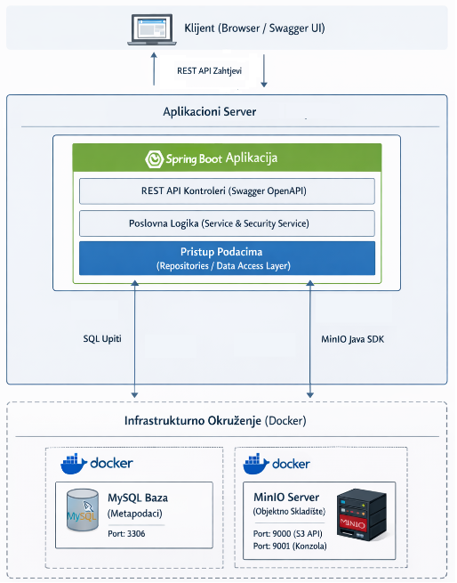

# MinIO Storage App


A Spring Boot backend that sits between clients and an S3-compatible MinIO store: file contents live in MinIO, metadata lives in MySQL, and business logic, access control and metadata management are handled in the application.

<div align="center">
  
</div>

## Key features

- **Authentication:** registration with email verification, JWT (access + refresh token) with refresh token rotation, password recovery
- **File management:** streaming uploads and downloads, presigned URLs and proxy streaming, advanced search with pagination
- **Versioning:** file version history and restoring older versions
- **Sharing:** public links with temporary tokens, expiry dates and a visit counter
- **Access control:** fine-grained, at the file, bucket and role level
- **Bucket policies:** lifecycle rules and a retention policy built on Object Lock
- **Statistics:** storage usage per user, bucket and category
- **Administration:** account management, health checks, synchronization between the database and MinIO
- **API documentation:** Swagger / OpenAPI

## Contents

- [Architecture](#architecture)
- [Technologies](#technologies)
- [Functionality overview](#functionality-overview)
- [Security](#security)
- [Project structure](#project-structure)
- [Prerequisites](#prerequisites)
- [Running the application](#running-the-application)

## Architecture

The system has three layers: a **client layer** (Swagger UI for testing the REST API), an **application layer** (Spring Boot: controllers, business logic, data access) and an **infrastructure layer** (MySQL and MinIO, both running in Docker containers).

The central design decision is to keep **metadata** (in MySQL) separate from **binary content** (on the MinIO server). The application layer coordinates both systems and tries to keep them consistent through a strict order of operations and compensation logic for partial failures.

Other design principles:

- **The database as the primary source of metadata:** reads, search and filtering go through the database only. MinIO is called only when the binary content or the versioning status is needed.
- **Fine-grained access control at file level:** the application layer extends MinIO's bucket-level control with more detailed policies.
- **Streaming file transfer:** the application does not store files locally or load entire files into memory. It streams them directly to and from MinIO.
- **Compensation:** the database and MinIO do not share a transaction context, so a failure in one system is compensated in the other (for example, an uploaded object is rolled back if the database write fails).

## Technologies

| Category | Technology |
|---|---|
| Language / Runtime | Java 17 |
| Framework | Spring Boot |
| Authentication | JWT (access + refresh token) |
| Database | MySQL |
| Object storage | MinIO (S3-compatible) |
| API documentation | Swagger / OpenAPI |
| Build tool | Apache Maven |
| Infrastructure | Docker, Docker Compose |

## Functionality overview

The application is organized into 12 controllers, each responsible for a distinct part of the system:

| Controller | Responsibility |
|---|---|
| **AuthController** | Registration with email verification, login (username or email), JWT with refresh token rotation, logout, password recovery, logging of critical events |
| **UserController** | Account administration: role assignment, activation/deactivation, protection of the system account, guarantee of at least one active admin, soft delete |
| **HealthController** | Liveness and readiness checks, database and MinIO status (UP/DEGRADED/DOWN), detailed metrics for administrators |
| **BucketController** | Creating and deleting buckets, changing their visibility, checking name availability, role-based views, enabling versioning |
| **FileCommandController** | Streaming uploads, deletion, metadata updates; atomic quota check and rollback on failure |
| **FileDownloadController** | Downloading and previewing files: presigned URLs and proxy streaming, filename sanitization, Unicode support |
| **FileQueryController** | Read-only access: file details, personal collection, public catalog, filtering, advanced search (POST) with pagination |
| **FileStatisticsController** | Storage usage statistics per user, bucket and category; admin view of the largest storage consumers |
| **ShareLinkController** | Public file sharing via temporary tokens without authentication, expiry dates, visit counter, deactivation/deletion |
| **FileVersionController** | File version history, restoring an older version, deleting a version (admin only), visibility inherited from the parent file |
| **BucketLifecycleController** | Lifecycle rules (automatic deletion/transition) and a retention policy based on Object Lock (GOVERNANCE/COMPLIANCE) |
| **BucketAdminController** | Synchronization between the database and the MinIO server, audit of orphaned and phantom records, recalculation of bucket statistics |

## Security

- JWT authentication with two tokens (access + refresh) and refresh token rotation; reuse of an already used token revokes the active sessions
- Verification keys and password reset tokens are stored in the database only as SHA-256 hashes
- Fine-grained access control at the file, bucket and role level (owner / bucket owner / administrator / public)
- Presigned URLs with a limited lifetime (900 s by default, 7200 s maximum)
- Filename sanitization on download to prevent HTTP header manipulation

## Project structure

```
minio-storage-app/
├── backend-app/          # Spring Boot application
│   ├── src/
│   └── pom.xml
└── docker-compose.yml    # MinIO, MySQL, phpMyAdmin
```

## Prerequisites

You need the following installed:

- Java 17
- Apache Maven
- Docker and Docker Compose

## Running the application

### 1. Start the Docker services

All infrastructure components start with a single command from the project root:

```bash
cd minio-storage-app
docker compose up -d
```

The following services are then available (default credentials for the local setup):

| Service | URL | User | Password |
|---|---|---|---|
| MinIO Console | http://localhost:9001 | minioadmin | minioadmin123 |
| MinIO API | http://localhost:9000 | minioadmin | minioadmin123 |
| phpMyAdmin | http://localhost:8081 | root | root123 |
| MySQL | localhost:3306 | root / appuser | root123 / appuser123 |

Database used: `minio_app`

### 2. Create the initial admin user

The initial admin user is created directly in the database, in the `users` table.

1. Open phpMyAdmin at [http://localhost:8081](http://localhost:8081) (user `root`, password `root123`)
2. Select the `minio_app` database, then the `users` table
3. Run the following SQL query:

```sql
INSERT INTO users (
    username,
    email,
    password,
    role,
    is_active,
    is_email_verified,
    created_at
) VALUES (
    'system',
    'system@storage.com',
    '$2a$10$6Ce95JzzT7BGz5mTOTDKiOmwHdx85oIy2ySrTHVokdef/vCrdYg3a',
    'ADMIN',
    1,
    1,
    NOW()
);
```

> This step bypasses the regular registration and email verification and creates a user with the admin role directly.
> **Username:** `system` &nbsp;·&nbsp; **Password:** `system123*`

### 3. Start the Spring Boot application

From the `backend-app` folder, run:

```bash
cd backend-app
mvn spring-boot:run
```

All dependencies are defined in `pom.xml` and are downloaded automatically on the first run.

### 4. Test the API through Swagger UI

Once the application is running, the API documentation is available at:
[http://localhost:8082/swagger-ui/index.html](http://localhost:8082/swagger-ui/index.html)

**Authentication:**

1. Find the `POST /auth/login` endpoint
2. Enter the credentials:
   ```json
   { "username": "system", "password": "system123*" }
   ```
3. Copy the JWT access token from the response
4. Click the **Authorize** button (top right of the Swagger interface)
5. Enter the token in the format `Bearer <token>`

After that, all protected endpoints can be tested.
